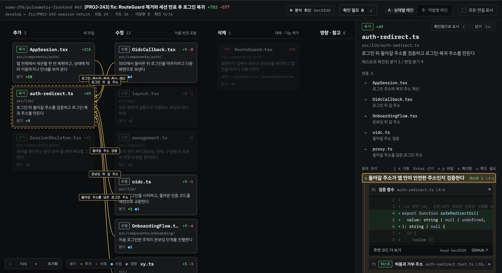

# PR Map

PR 변경 내용을 근거 코드가 연결된 자연어 트리 지도로 보여 주는 에이전트 스킬·CLI입니다.

AI·SW마에스트로 팀 프로젝트에서 AI로 코드 작성은 빨라졌지만, 리뷰어가 변경 사항을 리뷰하고 승인하는 데 긴 시간이 걸리는 것을 느껴 이를 줄이기 위해 만들었습니다.



## 설치

Node 20 이상, `git`, 로그인된 `gh`가 필요합니다.

```bash
npx skills add hong-jun-il/pr-map -g
```

한 저장소에서만 쓰려면 그 저장소에서 `-g` 없이 설치합니다.

분석할 저장소에서 에이전트를 열고 `/pr-map`을 실행합니다. 실행 중인 에이전트의 모델로 분석하므로 API 키는 필요 없습니다.

## 명령

| 명령                        | 동작                                                 |
| --------------------------- | ---------------------------------------------------- |
| `/pr-map`, `/pr-map <번호>` | PR을 분석하고 뷰어를 만들어 PR 댓글로 게시           |
| `/pr-map view`              | 뷰어를 열고, 그사이 새 커밋이 있는지 확인            |
| `/pr-map setup`             | 자동 실행 설치 PR을 만들고 시크릿 등록을 안내        |
| `/pr-map clean`             | 이 클론의 `.pr-map/`과 `.git/info/exclude` 줄을 삭제 |
| `/pr-map update`            | 새 버전을 확인하고, 승인하면 스킬 폴더를 교체        |

## 자동 실행

PR이 열리거나 커밋이 올라올 때마다 분석하려면 분석할 저장소에서 `/pr-map setup`을 실행합니다. 공급자를 고르면 워크플로 파일을 추가하는 설치 PR을 만들고, API 키를 저장소 시크릿으로 등록하도록 안내합니다. 설치 PR을 머지하면 다음 PR부터 실행됩니다.

키는 채팅에 붙여넣지 말고 터미널이나 GitHub 설정에서 등록하세요. `gh`가 없으면 출력된 링크에서 PR과 시크릿을 직접 만듭니다.

| 공급자 | 시크릿 이름         | 상태                 |
| ------ | ------------------- | -------------------- |
| Claude | `ANTHROPIC_API_KEY` | 실제 실행으로 확인함 |
| Codex  | `OPENAI_API_KEY`    | 실행 검증 전         |
| Gemini | `GEMINI_API_KEY`    | 실행 검증 전         |

PR 코드는 고른 공급자의 API로 전송되고, 사용량은 등록한 키에 청구됩니다.

같은 저장소에서 연 PR만 분석합니다. 포크 PR, 초안, Dependabot PR, `no-pr-map` 라벨이 붙은 PR은 건너뜁니다. 라벨을 떼면 다음 푸시 때 분석합니다.

### `action.yml` 입력

| 입력             | 기본값         | 설명                                   |
| ---------------- | -------------- | -------------------------------------- |
| `provider`       | `claude`       | `claude`, `codex`, `gemini`            |
| `api-key`        | 필수           | 저장소 시크릿으로 넘기는 API 키        |
| `github-token`   | `github.token` | PR 조회와 댓글 게시용 토큰             |
| `model`          | 공급자 기본값  | 분석 모델                              |
| `max-turns`      | `80`           | 최대 턴 수 (Claude, Gemini)            |
| `max-budget-usd` | `5`            | 실행당 비용 상한, 추정치 기준 (Claude) |
| `cli-version`    | 고정 버전      | 설치할 공급자 CLI 버전                 |

Codex와 Gemini는 비용 상한을 지원하지 않습니다. 공급자 쪽 지출 한도를 설정하세요.

## 설정

저장소 루트에 `.pr-map.yml`을 두면 분석 범위를 바꿀 수 있습니다.

```yaml
exclude: # 지도에서 뺄 경로 (글롭)
  - docs/**
  - "**/*.gen.ts"
maxFiles: 50 # 넘으면 변경량이 작은 파일부터 미분류로 표시
includeTests: true # 테스트도 지도에 넣기 (기본: 제외)
```

테스트 코드, 스토리, 테스트 러너 설정(`playwright`·`vitest`·`jest`·`cypress`)은 기본으로 미분류에 남습니다.

## 보안

PR 코드는 신뢰할 수 없는 입력으로 다룹니다.

- 분석 단계에는 GitHub 토큰을 넘기지 않습니다.
- Claude는 네트워크 도구와 저장소의 `.claude` 설정, 훅, MCP를 끄고 쓰기를 `.pr-map/`으로 제한합니다.
- Codex와 Gemini는 코드를 읽기만 하고, 저장과 검증은 스크립트가 합니다. 분석 전에 일회용 체크아웃에서 `.codex`, `.gemini`, `AGENTS.md`, `GEMINI.md`를 지웁니다.
- 코드 원문은 외부 서버에 올리지 않습니다. 뷰어는 로컬이나 저장소의 Actions artifact에만 있습니다.
- 분석 결과를 담는 `.pr-map/`에는 코드 원문이 들어 있어 `.git/info/exclude`에 등록합니다.
- 뷰어를 연 뒤 주소창의 주소는 임시 서명 주소입니다. 공유할 때는 PR 댓글의 링크를 쓰세요.

## 제한

- 관계 후보 추출과 구문 강조는 TS/JS만 지원합니다. 다른 언어는 에이전트가 코드를 읽어 관계를 찾습니다.
- 줄 위치는 커밋에서 검증하지만, 설명의 의미는 검증하지 않습니다.
- 뷰어 링크는 GitHub 로그인이 필요하고 14일 뒤 만료됩니다. 로컬 실행으로 올린 댓글에는 링크가 없어 `/pr-map view`로 엽니다.

## 업데이트 알림

하루 한 번 GitHub의 `vX.Y.Z` 태그를 확인해 새 버전이 있으면 알립니다. CI에서는 확인하지 않고, `PR_MAP_NO_UPDATE_CHECK=1`로 끌 수 있습니다.

## 제거

1. 저장소마다 `/pr-map clean`을 실행합니다. 스킬을 먼저 지우면 이 명령을 쓸 수 없습니다.
2. `npx skills remove pr-map`으로 스킬을 지웁니다. 직접 복사했다면 `.claude/skills/pr-map` 또는 `~/.claude/skills/pr-map`을 삭제합니다.
3. 자동 실행을 설치했다면 `.github/workflows/pr-map.yml`과 API 키 시크릿을 지웁니다.

PR 댓글은 자동으로 지우지 않습니다.

## 개발

```bash
npm install
npm test            # 번들 후 전체 테스트
npm run typecheck
npm run lint        # ESLint (타입 정보를 쓰는 규칙 포함)
npm run demo        # 예시 PR로 임시 저장소를 만들어 뷰어를 연다 (--stale: 새 커밋 상태)
```

`npm run build`는 `src/`를 `skill/pr-map/scripts/pr-map.js`와 `skill/pr-map/assets/viewer.html`로 번들합니다. 설치한 스킬이 의존성 없이 실행되도록 번들 결과도 커밋합니다.

릴리스할 때는 `package.json`의 버전을 올려 빌드한 커밋에 같은 번호의 태그를 붙입니다.

```text
spec/            스키마, validate 규칙 (AI 출력 계약)
skill/pr-map/    배포물: SKILL.md + 번들
action.yml       GitHub Actions 액션 (action/의 스크립트를 실행)
src/cli/         수집, 검증, 빌드, 댓글, 게시, 삭제
src/viewer/      React 뷰어
test/            실제 git 저장소를 만들어 검증하는 테스트
test/fixtures/   테스트와 데모에 쓰는 예시 PR 분석 결과
eval/            분석 품질과 토큰 사용량 평가
```

- [평가](eval/README.md)
- [결정 기록](docs/adr/README.md)
- [에이전트 작업 안내](AGENTS.md)
- [뷰어 디자인 원본](https://claude.ai/design/p/55f2fe88-6c0a-4448-b278-e568ed4a0554?file=PR+Map+Lanes.dc.html)

## 라이선스

[MIT](LICENSE)
